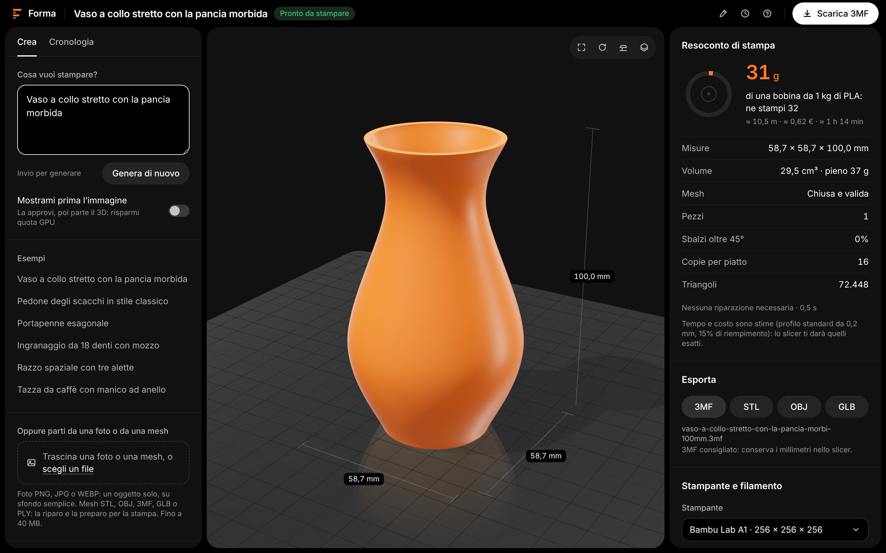
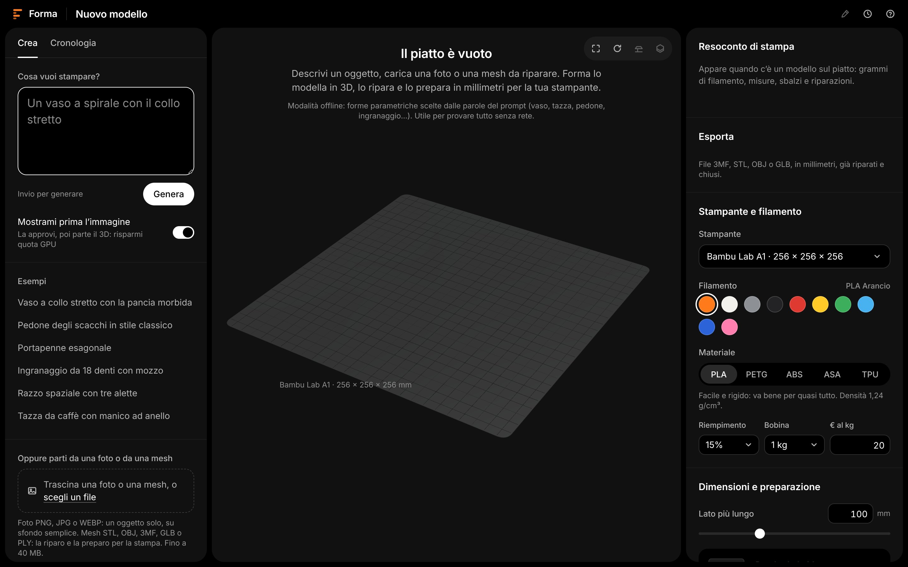
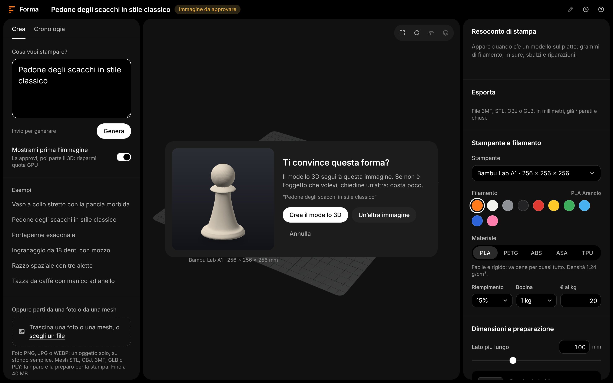
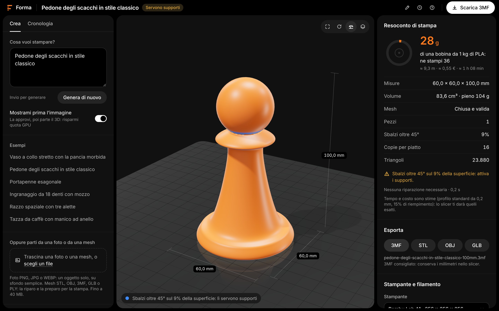
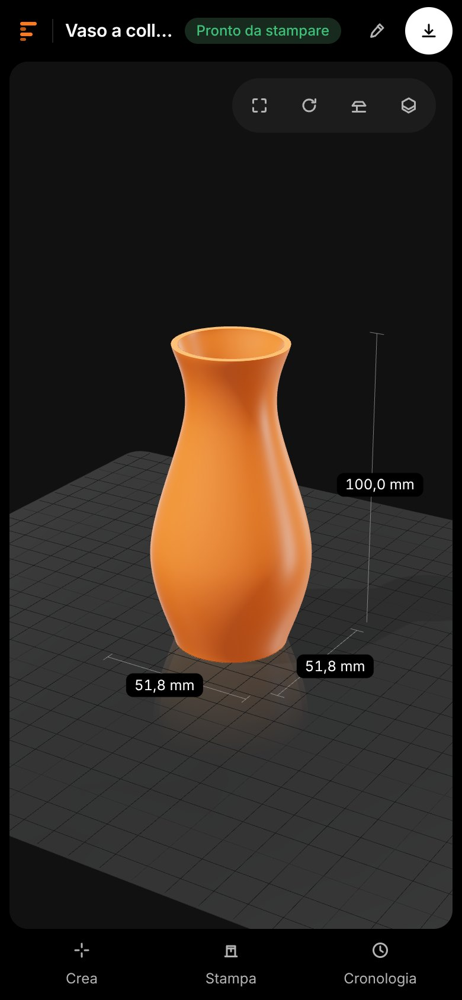

# Forma

Da una frase, da una foto o da una mesh qualsiasi a un modello 3D pronto per la tua stampante:
generato con i migliori modelli open, riparato, orientato, messo in scala in millimetri e
modificabile a mano nel browser.



## Cosa fa

- **Testo → immagine → 3D.** Scrivi cosa vuoi stampare; FLUX.1-schnell crea un'immagine "da
  prodotto" (oggetto singolo, centrato, sfondo neutro). Puoi **approvarla o chiederne un'altra**
  prima di partire col 3D, il passaggio lento che consuma quota GPU.
- **Immagine → 3D** con **Pixal3D** (predefinito) o le alternative: TRELLIS.2, Step1X-3D,
  Hunyuan3D 2.1/2mv, TRELLIS. Se lo Space del modello scelto non risponde, Forma passa da solo a
  TRELLIS.2.
- **Ripara qualsiasi mesh**: trascina un file STL, OBJ, 3MF, GLB o PLY e viene chiuso, reso
  manifold e preparato.
- **Pipeline di stampa**: rimozione dei frammenti, chiusura dei buchi, ricostruzione voxel se
  serve, normali, orientamento (in piedi livellato, **meno supporti**, disteso), scala in mm,
  svuotamento con pareti misurate dalla superficie vera, base d'appoggio, semplificazione che non
  rompe la chiusura.
- **Resoconto**: grammi di filamento per PLA, PETG, ABS, ASA o TPU con il tuo riempimento,
  bobina e prezzo; metri, costo, stampe per bobina, tempo stimato per la tua stampante, copie per
  piatto, sbalzi oltre 45°, riparazioni eseguite.
- **Viewport**: luci da studio, ombre morbide, riflesso sul piatto, griglia da 10/50 mm, quote in
  mm, rivelazione a strati, **mappa degli sbalzi**, **vista in sezione**, verifica del piatto
  (Bambu Lab A1, Prusa MK4, Ender 3 o personalizzata).
- **Modifica a mano**: sposta con selezione morbida e 5 curve di caduta, leviga, gonfia/sgonfia,
  simmetria X, annulla/ripeti; "Ripara e aggiorna" salva il risultato come nuovo modello.
- **Esporta** in 3MF (millimetri, consigliato), STL binario, OBJ o GLB (metri, Y in alto),
  con un nome che dice cos'è e quanto è grande: `pedone-degli-scacchi-100mm.3mf`.

## Schermate

| | |
| --- | --- |
|  |  |
| Primo avvio, piatto vuoto | L'immagine da approvare prima del 3D |
|  |  |
| Stadi con l'immagine di partenza (stato bloccato a metà per la foto) | Mappa degli sbalzi da sostenere |
|  |  |
| Sezione di una sfera svuotata: le pareti | Modifica con simmetria X |

Su tablet e telefono il viewport viene prima e i pannelli diventano fogli dal basso:

| | | |
| --- | --- | --- |
|  |  |  |

## Avvio rapido

Servono [uv](https://docs.astral.sh/uv/) (Python 3.11+) e Node.js 22+.

```bash
git clone https://github.com/EmanueleCavaliero/pjsr.git forma && cd forma
make install
cp .env.example .env      # facoltativo: qui va HF_TOKEN
make dev                  # backend + frontend: apri http://localhost:5173
```

Altri modi:

| Comando | Cosa fa |
| --- | --- |
| `make offline` | Tutto senza rete né token: forme procedurali dalle parole del prompt (vaso, tazza, pedone, ingranaggio, razzo…). Perfetto per provare l'app. |
| `make serve` | Build di produzione servita dal backend: http://localhost:8000 |
| `make docker` | Immagine CPU con Docker Compose: http://localhost:8000 |
| `make test` | pytest (backend) e vitest (frontend) |
| `make e2e` | 18 flussi end-to-end in Chromium su dati temporanei (serve Playwright: `cd frontend && npm i --no-save playwright && npx playwright install chromium`) |
| `make help` | Tutti i comandi |

### Mac senza GPU (predefinito: `hf_remote`)

I modelli girano sugli Space di Hugging Face; il Mac fa solo l'interfaccia e la preparazione della
stampa (pochi secondi in CPU). Funziona anche **senza token**, con la quota anonima degli Space: può
esserci coda e la quota finisce presto, perché Pixal3D chiede fino a 30 + 120 + 240 secondi di GPU per
modello. Con un token va molto meglio (vedi sotto).

### Linux con GPU NVIDIA (`local`)

Per avere tutto in casa, senza code né quote: GPU con almeno 24 GB di VRAM (Pixal3D ha anche una
modalità low-VRAM che abbassa il picco), CUDA 12.4.

```bash
make install-gpu                   # torch, diffusers (FLUX.1-schnell), transformers…
# poi i pacchetti dei modelli, come dicono i loro README:
git clone --recursive https://github.com/microsoft/TRELLIS.2.git
(cd TRELLIS.2 && . ./setup.sh --basic --flash-attn --nvdiffrast --nvdiffrec --cumesh --o-voxel --flexgemm)
git clone https://github.com/TencentARC/Pixal3D.git && pip install -r Pixal3D/requirements.txt
export PYTHONPATH=$PWD/Pixal3D:$PWD/TRELLIS.2
GEN_PROVIDER=local make dev
```

Oppure `make docker-gpu`: l'immagine `Dockerfile.gpu` fa gli stessi passi (CUDA 12.4, PyTorch 2.6,
installer ufficiali ai commit verificati) e risponde su http://localhost:8001. La prima generazione
scarica i pesi (alcune decine di GB) nel volume `forma-data`.

## HF_TOKEN, quota e costi

1. Crea un account su [huggingface.co](https://huggingface.co) e un token in
   [Settings → Access Tokens](https://huggingface.co/settings/tokens) (tipo *Read*).
2. Mettilo in `.env`: `HF_TOKEN=hf_...` e riavvia.

Con il token FLUX passa per gli Inference Providers (più veloce e affidabile) e gli Space usano la tua
quota ZeroGPU invece di quella anonima. A novembre 2026 l'abbonamento **PRO costa 9 $ al mese** e dà
circa **8 volte la quota ZeroGPU** gratuita con priorità in coda; oltre la quota si possono comprare
minuti (1 $ ogni 10 minuti). I minuti esatti al giorno cambiano: controlla
[huggingface.co/pricing](https://huggingface.co/pricing). Con la quota gratuita e Pixal3D conviene
tenere attiva "Mostrami prima l'immagine": il 3D parte solo quando l'immagine ti convince.

## Uso

1. **Descrivi l'oggetto** (o trascina una foto, o una mesh da riparare). Gli esempi a sinistra sono
   un buon punto di partenza.
2. **Approva l'immagine** o chiedine un'altra; poi segui gli stadi *Immagine → Forma 3D →
   Riparazione → Pronto*. Gli errori compaiono nel pannello, con *Riprova*.
3. **Controlla il resoconto**: grammi, costo, tempo, sbalzi (tasto O per vederli sul modello), la
   sezione (tasto C) se l'hai svuotato.
4. **Regola stampante, filamento, dimensione, orientamento, svuotamento, base** e premi *Applica*.
   "Adatta al piatto" porta il modello alla misura massima della tua stampante.
5. **Modifica a mano** se serve (tasto E), poi *Ripara e aggiorna*.
6. **Scarica il 3MF** (o STL, OBJ, GLB) e aprilo nello slicer.

### Scorciatoie

| Tasti | Azione |
| --- | --- |
| Invio · ⌘/Ctrl Invio | Genera (dal prompt · da ovunque) |
| / | Scrivi il prompt |
| E | Modifica la forma |
| G · S · I | Sposta · Leviga · Gonfia (Maiusc: sgonfia) |
| X | Simmetria sull'asse X |
| [ · ] (anche − · +) | Raggio del pennello |
| ⌘/Ctrl Z · ⌘/Ctrl ⇧ Z | Annulla · Ripeti |
| F | Inquadra il modello |
| O | Mostra gli sbalzi |
| C | Vista in sezione |
| Spazio | Rotazione automatica |
| H | Cronologia |
| ? | Elenco delle scorciatoie |
| Esc | Chiudi, esci dalla modifica o dalla sezione |

## Scelta del modello

La scelta guarda alla **qualità della geometria per la stampa**, non alle texture. Verificata il
4 novembre 2026 sui repository ufficiali (licenze lette nei file `LICENSE` e `NOTICE`).

| Modello | Licenza | Note |
| --- | --- | --- |
| **Pixal3D** (TencentARC, SIGGRAPH 2026) · predefinito | MIT, codice e pesi | È TRELLIS.2 (stessa rappresentazione O-Voxel, fino a 1536³) con il condizionamento allineato ai pixel: le feature dell'immagine vengono proiettate in 3D con la camera stimata da MoGe-2, quindi la forma segue l'immagine molto più fedelmente. Gli autori dichiarano prestazioni migliori di TRELLIS.2; non ho trovato benchmark indipendenti consultabili. |
| **TRELLIS.2** (Microsoft, dic. 2025) | MIT | La base di Pixal3D, più leggera sugli Space. Fallback automatico. |
| **Step1X-3D** (StepFun) | Apache-2.0 | SDF con bordi netti, utile per oggetti meccanici (forza la simmetria X). |
| **Hunyuan3D 2.1 / 2mv** (Tencent) | Tencent Hunyuan 3D Community License | **Non valida nell'Unione Europea (Italia inclusa), nel Regno Unito e in Corea del Sud**, nemmeno per l'output. In Forma è etichettato "Non valido in UE": non usarlo dall'Italia. |
| **TRELLIS** v1 (Microsoft) | MIT | Il predecessore, per confronto. |

Valutato e non integrato: **Hi3D v1.0** (ex Sparc3D, ottobre 2026) rifinisce una mesh esistente
invece di generarla, ha una licenza propria con obbligo di attribuzione e una demo su uno Space
personale. Per il testo → immagine resta **FLUX.1-schnell** (Apache-2.0, servito ovunque);
Z-Image-Turbo (Apache-2.0) è un candidato da provare, si imposta con `HF_FLUX_MODEL` se un
Inference Provider lo serve.

TRELLIS.2 e Pixal3D usano l'encoder DINOv3 di Meta, distribuito con la sua licenza (accesso da
approvare su Hugging Face): serve solo per l'inferenza locale.

## Architettura

```
frontend/  Vite + TypeScript + three.js, senza framework UI
  src/app.ts            stato e azioni (store osservabile)
  src/viewer/           scena, piatto, quote, rivelazione, sbalzi, sezione
  src/edit/             saldatura, adiacenze, pennelli, undo/redo, writer STL (puri, testati)
  src/ui/               top bar, pannelli, overlay del viewport, scorciatoie, toast
  src/lib/              API, stampanti, filamenti e contrasto, materiali e stime, formati italiani
backend/   FastAPI
  app/providers/        hf_remote · local · procedural, stessa interfaccia generate() / image()
  app/providers/endpoints/  un modulo per Space (argomenti presi dagli app.py upstream)
  app/pipeline/         riparazione, orientamento, svuotamento, base, report
  app/exporters.py      STL, 3MF in mm, OBJ, GLB
```

| API | |
| --- | --- |
| `GET /api/providers` | Provider, modelli con licenze e note, impostazioni predefinite |
| `POST /api/image` | Solo testo → immagine: una bozza da approvare |
| `POST /api/generate` | Avvia un job da prompt, foto o bozza (`draft`) |
| `GET /api/jobs/{id}` | Stadi, messaggi della coda, immagine intermedia, risultato |
| `POST /api/process` | Ripete la preparazione con nuove impostazioni, o ripara una mesh caricata/modificata |
| `GET /api/export/{id}?format=stl\|3mf\|obj\|glb` | Download |
| `GET /api/models`, `GET/DELETE /api/models/{id}` | Cronologia |

Configurazione in `.env` (vedi `.env.example`): provider, modello e fallback, Space usati (puoi
puntare a un tuo duplicato), cartella dei dati.

## Qualità

- **Backend**: 94 test pytest (pipeline, provider con client Gradio simulato, API, export).
- **Frontend**: 64 test vitest (curve di caduta, saldatura, pennelli, undo/redo, STL, contrasto,
  piatto, materiali e stime).
- **End-to-end**: 18 flussi in Chromium contro il backend vero (`make e2e`).
- La preparazione di una mesh AI da 327.000 triangoli rumorosa e bucata richiede circa 4 s con le
  impostazioni predefinite e 7 s con svuotamento e base, su una CPU da portatile.

## Limiti noti

- **Gli Space di Hugging Face non sono stati chiamati davvero**: l'ambiente di sviluppo blocca
  huggingface.co. Gli adapter seguono gli `app.py` pubblicati dagli autori e sono testati con un
  client simulato; se uno Space cambia API, la correzione sta in un solo file di
  `backend/app/providers/endpoints/`, e intanto entra in gioco il fallback.
- **L'immagine Docker GPU** non è stata costruita (né demone Docker né GPU nell'ambiente di
  sviluppo); quella CPU ha la configurazione validata con `docker compose config`.
- **Tempo e costo** sono stime da un profilo standard da 0,2 mm: lo slicer dà quelli esatti.
- La scultura lavora sulla mesh preparata (fino a 150.000 triangoli di default): su mesh molto più
  grandi i pennelli rallentano.

## Licenza

Il codice di Forma è sotto licenza MIT. I modelli hanno le loro licenze (tabella sopra); FLUX.1-schnell
è Apache-2.0.
