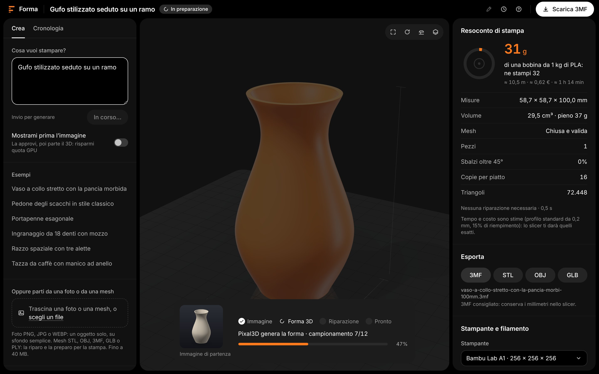
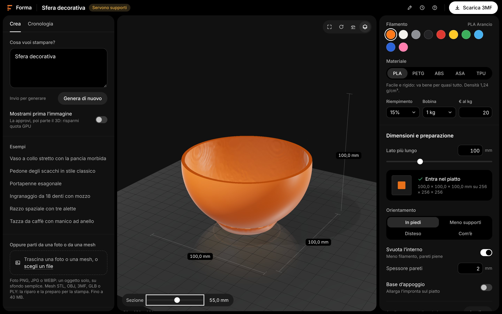
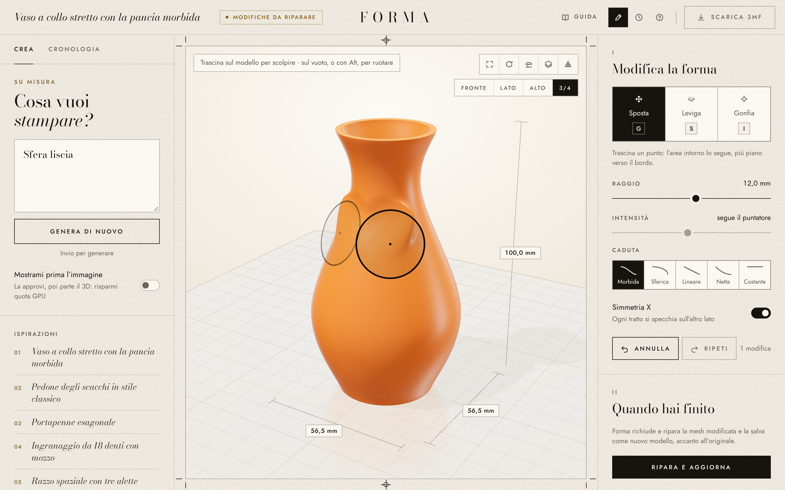
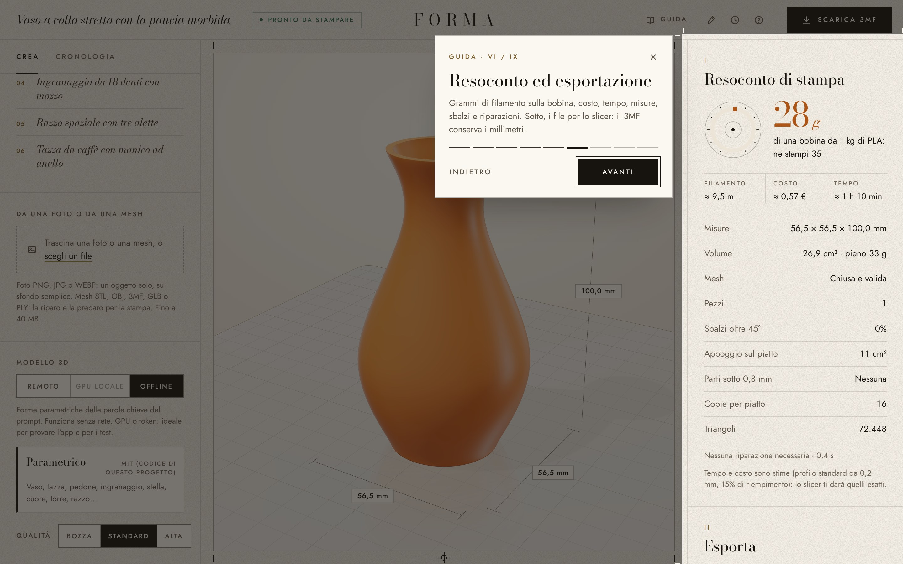
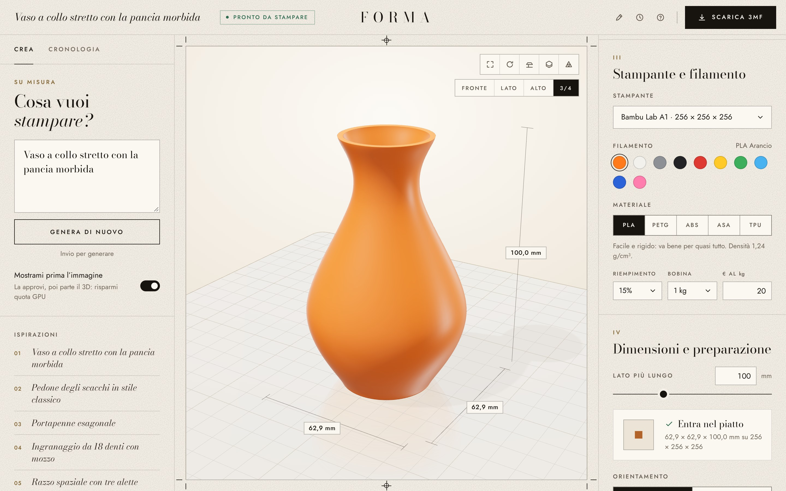
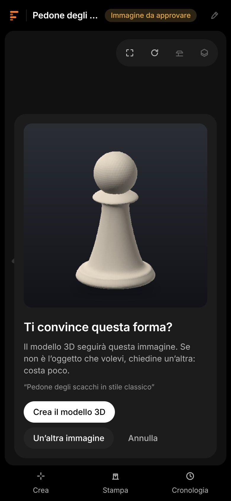
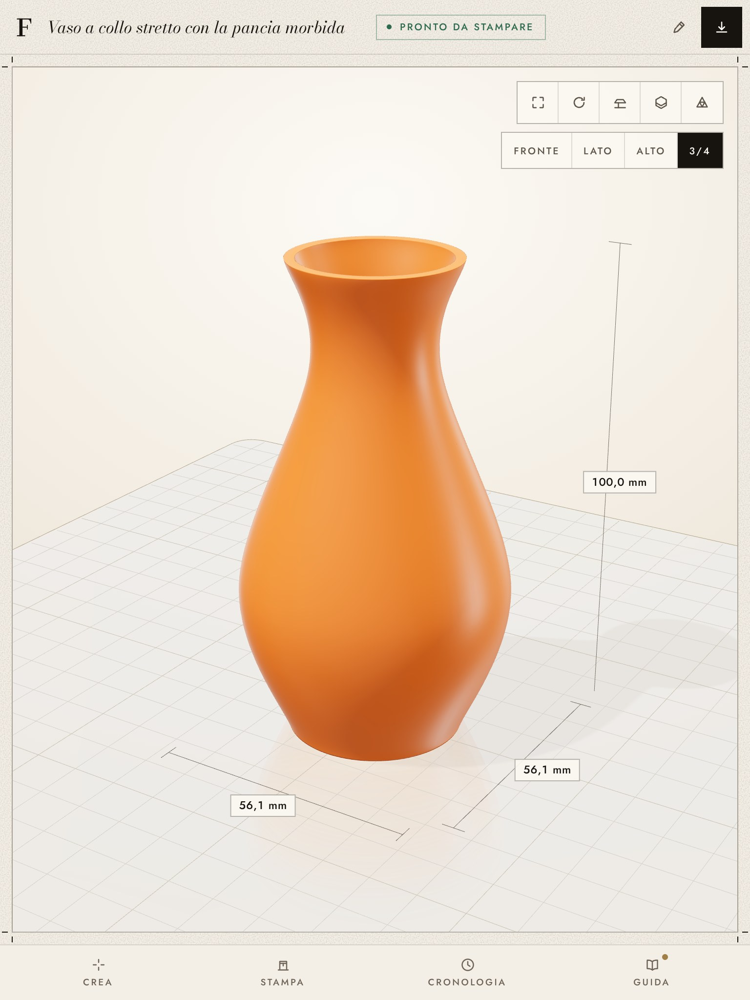
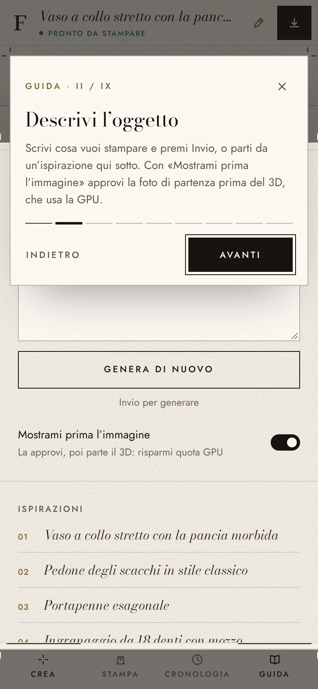
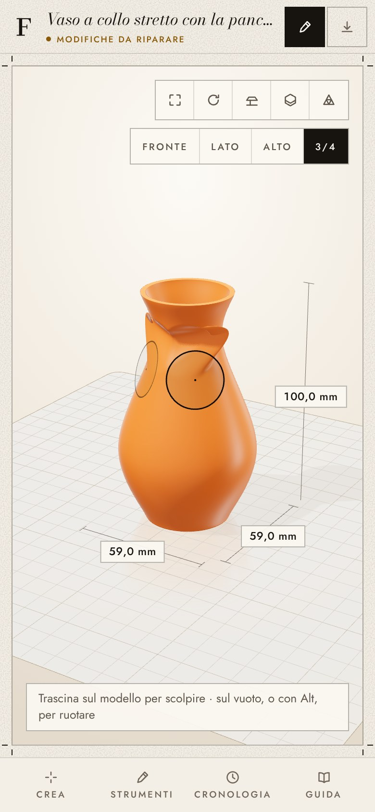
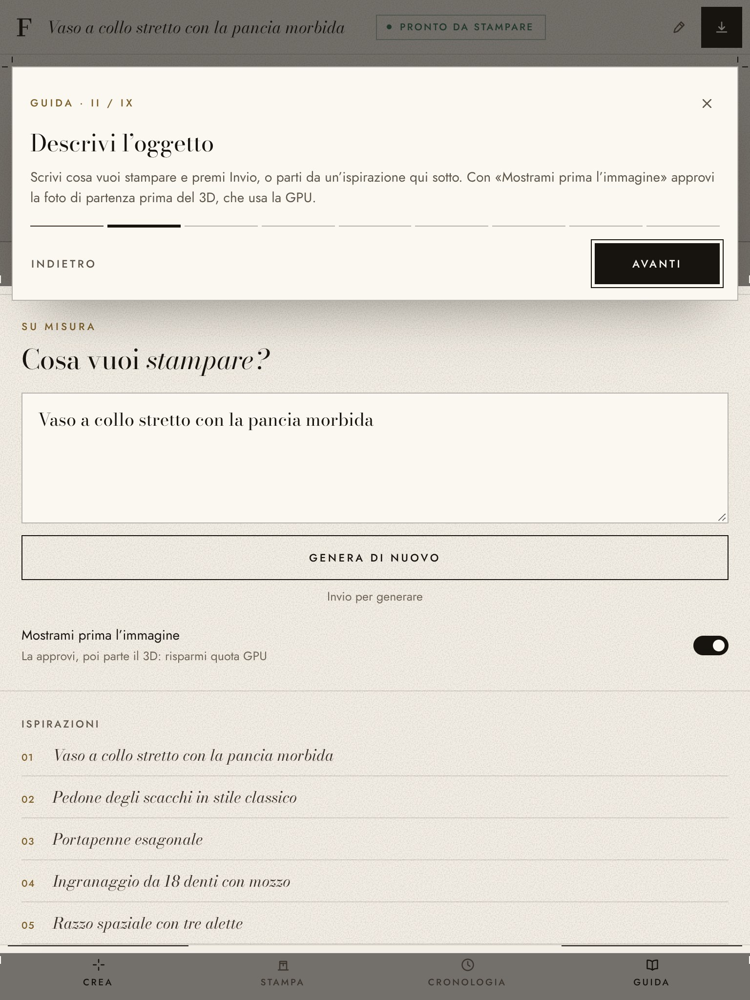

# Forma

Da una frase, da una foto o da una mesh qualsiasi a un modello 3D pronto per la tua stampante:
generato con i migliori modelli open, riparato, orientato, messo in scala in millimetri e
modificabile a mano nel browser.


## Cosa fa

- **Testo → immagine → 3D.** Scrivi cosa vuoi stampare; FLUX.1-schnell crea un'immagine "da
  prodotto" (oggetto singolo, centrato, sfondo neutro). Puoi **approvarla o chiederne un'altra**
  prima di partire col 3D, il passaggio lento che consuma quota GPU. I prompt in italiano vengono
  tradotti in inglese per FLUX (con HF_TOKEN), e l'anteprima mostra la frase inviata.
- **Immagine → 3D**: sotto "Cosa vuoi stampare?" scegli **Testo** o **Immagine**; con Immagine il
  campo diventa un riquadro dove trascini, incolli o scegli una foto (ne vedi l'anteprima). Da
  un'immagine scegli il modello sotto "Modello 3D": **Idol sulla tua GPU NVIDIA** (predefinito, vedi
  sotto) o uno degli Space di Hugging Face col tuo token: **Pixal3D, TRELLIS.2, Hunyuan3D 2.1,
  Step1X-3D, Hunyuan3D 2mv, TRELLIS** (gli Hunyuan sono segnati "Non valido in UE"). Il modello
  scelto per un'immagine è quello e basta: se lo Space non risponde o la GPU manca, Forma lo dice
  invece di passare a un altro (`IMAGE_TO_3D`, predefinito `local:idol,hf_remote:*`). Dal testo
  scegli allo stesso modo; lì, se lo Space scelto non risponde, Forma passa da solo a TRELLIS.2.
- **Colori del modello AI.** La texture di Meshy, Pixal3D o TRELLIS.2 diventa un colore per vertice
  letto **alla risoluzione della texture**: prima la mesh viene suddivisa (stessa superficie, le
  coordinate UV seguono i nuovi vertici, le cuciture si dividono in coppia e restano chiuse), circa
  un vertice per pixel usato della texture (2048 px: ~5,4 milioni di triangoli; 4096 px: il tetto
  di 10 milioni), poi la texture si legge in ogni vertice. Prima si leggeva solo nei vertici del
  modello (Meshy in Alta: ~350 mila, un colore ogni ~45 pixel) e i colori venivano sfocati. Il
  colore resta lungo tutta la preparazione (riparazione, svuotamento, base, modifica a mano) e si vede
  nella vista 3D e nelle miniature. Per stamparlo a colori esporta in **OBJ** e trascinalo in
  **Bambu Studio**: scegli quanti colori usare e lo slot AMS di ciascuno. Anche il GLB tiene i
  colori (un colore per vertice, `COLOR_0`, in luce lineare a 16 bit come chiede glTF: scritti in
  sRGB, Blender mostrava un rosso come rosa pallido) con un materiale opaco non metallico. **In
  Blender** si vedono nella vista Material Preview
  (tasto Z) o Rendered, oppure in Solid con Colore → Attributo; la vista Solid di partenza mostra
  il materiale tutto grigio. Più semplice: **"Apri in Blender"** (sotto i formati, se Blender è
  installato su questo computer) apre Blender con il modello già importato, senza il cubo di
  partenza, inquadrato, in Material Preview e con la trasformazione colore Standard (AgX, quella
  di Blender, spegne i colori forti). Blender si trova da solo (anche quello del Microsoft
  Store); altrimenti `BLENDER_PATH` nel `.env`. STL e 3MF restano monocolore. I modelli generati prima di questa versione non hanno
  colori: vanno rigenerati.
- **Ripara qualsiasi mesh**: trascina un file STL, OBJ, 3MF, GLB o PLY in un punto qualsiasi della
  finestra (o incollalo) e viene chiuso, reso manifold e preparato. Anche una foto si può
  trascinare o incollare.
- **Rinomina** un modello cliccando sul suo nome in alto: il nome passa anche ai file esportati.
- **Guida**: il tasto *Guida* in alto (su tablet e telefono nella barra in basso, e anche nella
  copertina del primo avvio) fa un giro dell'interfaccia in nove passi. Ogni passo apre il pannello
  giusto, evidenzia la zona e spiega cosa fa; ← → per muoverti, Esc per uscire. Alla fine pannelli e
  modifica tornano com'erano.
- **Pipeline di stampa**: rimozione dei frammenti, chiusura dei buchi, ricostruzione voxel se
  serve, normali, orientamento (in piedi livellato, **meno supporti**, disteso), scala in mm,
  **base piana** (taglia il fondo per più presa sul piatto), svuotamento con pareti misurate dalla superficie vera, base d'appoggio.
  **Ogni modello arriva sul piatto con almeno 5 milioni di triangoli e ne tiene fino a 10 milioni
  dei suoi**, qualunque sia la qualità: il dettaglio calcolato dal modello non si butta (Meshy in
  Alta ne fa fino a ~10 milioni). Pixal3D e Step1X-3D ne chiedono 10 milioni allo Space, TRELLIS.2
  il massimo del suo, 500 mila; la texture dei colori va da 1024 px a 4096 px in qualità Alta. La
  riparazione lavora sulla mesh intera, la semplificazione (che non rompe la chiusura) scatta solo
  oltre i 10 milioni, e una mesh che ne ha meno di 5 milioni (TRELLIS.2, la ricostruzione voxel,
  un file caricato, le forme offline) viene
  **suddivisa** alla fine: nuovi vertici a metà dei lati, prima i più lunghi, senza crepe. La forma
  resta identica (spigoli vivi e misure in mm compresi) e i colori si sfumano lungo
  i lati.
- **Resoconto**: grammi di filamento per PLA, PETG, ABS, ASA o TPU con il tuo riempimento,
  bobina e prezzo; metri, costo, stampe per bobina, tempo stimato per la tua stampante, copie per
  piatto, sbalzi oltre 45°, area d'appoggio sul piatto, **parti più sottili di 0,8 mm** (con
  avviso e fattore d'ingrandimento suggerito), riparazioni eseguite.
- **Viewport**: luci da studio, ombre morbide, riflesso sul piatto, griglia da 10/50 mm, quote in
  mm, rivelazione a strati, **mappa degli sbalzi**, **vista in sezione**, **viste rapide** (fronte,
  lato, alto, 3/4), **triangoli della mesh**, verifica del piatto
  (Bambu Lab A1, Prusa MK4, Ender 3 o personalizzata).
- **Modifica a mano**: sposta con selezione morbida e 5 curve di caduta, leviga, gonfia/sgonfia,
  simmetria X, annulla/ripeti; "Ripara e aggiorna" salva il risultato come nuovo modello.
- **Esporta** in 3MF (millimetri, consigliato), STL binario, OBJ o GLB (metri, Y in alto),
  con un nome che dice cos'è e quanto è grande: `pedone-degli-scacchi-100mm.3mf`. Ogni pulsante di
  download apre un popup che segue il file fino all'ultimo byte: **Converto → Controllo → Scarico**,
  con la percentuale, il tempo che manca e i MB arrivati. Prima di dartelo il server **rilegge il
  file e lo confronta col modello** (numero di vertici e triangoli, primo e ultimo, CRC di tutto
  l'archivio 3MF); la pagina controlla poi di aver ricevuto esattamente quei byte. Un file
  incompleto o corrotto non viene mai salvato: il popup dice perché e offre Riprova. Annulla ferma
  anche il server, e il file sul server sparisce appena scaricato.

## Aspetto

Lo stile si chiama **Atelier**: il lookbook di una maison di moda, su carta avorio.

- **Bodoni Moda** per titoli, cifre grandi e logo: un carattere didone ad alto contrasto, come
  sulle copertine delle riviste di moda. Più il testo è grande, più i tratti sottili sono fini.
- **Jost** per etichette in maiuscole spaziate e testo: un sans serif geometrico ispirato al Futura,
  quello del logo Louis Vuitton. Entrambi sono OFL-1.1, inclusi nell'app con i pacchetti Fontsource.
- **Carta e inchiostro**: grana appena visibile, filetti al posto dei riquadri, angoli vivi, bottoni
  neri, oro solo per ornamenti e numerazioni. I dati hanno un solo colore, quello del filamento che
  scegli: sulla carta è scurito quanto basta per un contrasto di 4,5:1, nel 3D resta vero.
- **Scena 3D**: fondale da studio avorio, piatto color pietra chiara con un riflesso morbido, come
  l'acrilico lucido di una foto di prodotto. Attorno, i segni di taglio e di registro di una
  tipografia.
- **Movimento**: il modello si stampa strato per strato con una testina di luce; il colore del
  filamento sfuma, le viste girano con un respiro di camera, le quote si disegnano. Gli indicatori
  d'inchiostro scivolano tra le scelte, ogni scorciatoia mostra il suo tasto a schermo, la copertina
  del primo avvio entra come i titoli di un film. Con "riduci movimento" del sistema tutto si ferma.

## Schermate

| | |
| --- | --- |
|  |  |
| Primo avvio, piatto vuoto | L'immagine da approvare prima del 3D |
|  |  |
| Stadi con l'immagine di partenza (stato bloccato a metà per la foto) | Mappa degli sbalzi da sostenere |
|  |  |
| Sezione di una sfera svuotata: le pareti | Modifica con simmetria X |
|  |  |
| La guida al passo VI: resoconto ed esportazione | Stampante, filamento e verifica del piatto |

Su tablet e telefono il viewport viene prima e i pannelli diventano fogli dal basso:

| | | |
| --- | --- | --- |
|  |  |  |
|  |  |  |

## Avvio rapido

Servono [uv](https://docs.astral.sh/uv/) (Python 3.11+) e Node.js 22+.

```bash
git clone https://github.com/EmanueleCavaliero/pjsr.git forma && cd forma
make install
cp .env.example .env      # facoltativo: qui va HF_TOKEN
make dev                  # backend + frontend: apri http://localhost:5173
```

Altri modi:

| Comando | Cosa fa |
| --- | --- |
| `make offline` | Tutto senza rete né token: forme procedurali dalle parole del prompt (vaso, tazza, pedone, ingranaggio, razzo…). Perfetto per provare l'app. |
| `make serve` | Build di produzione servita dal backend: http://localhost:8000 |
| `make docker` | Immagine CPU con Docker Compose: http://localhost:8000 |
| `make test` | pytest (backend) e vitest (frontend) |
| `make e2e` | 24 flussi end-to-end in Chromium su dati temporanei (serve Playwright: `cd frontend && npm i --no-save playwright && npx playwright install chromium`) |
| `make screenshots` | Rifà le schermate di questo README in `docs/screenshots` (desktop 1440×900, tablet 768×1024, telefono 390×844, a 2×) con `frontend/e2e/screens.cjs`, su dati temporanei e provider offline (serve Playwright, come per `make e2e`) |
| `make help` | Tutti i comandi |

Per far girare `make e2e` e `make screenshots` accanto a `make dev`, cambia le porte del backend e
del frontend (predefinite 8000 e 4173): `make e2e E2E_API=8100 E2E_WEB=4273`.

### Mac senza GPU (predefinito: `hf_remote`)

I modelli girano sugli Space di Hugging Face; il Mac fa solo l'interfaccia e la preparazione della
stampa (pochi secondi in CPU). Funziona anche **senza token**, con la quota anonima degli Space: può
esserci coda e la quota finisce presto, perché Pixal3D chiede fino a 30 + 120 + 240 secondi di GPU per
modello. Con un token va molto meglio (vedi sotto).

### Idol sulla tua GPU NVIDIA da 8 GB, anche su Windows (`local`, predefinito in locale)

[Idol](https://huggingface.co/speridlabs/idol) (speridlabs, ottobre 2026, Apache-2.0) trasforma
un'immagine in un milione di gaussiane 3D. Forma le converte in un solido chiuso a colori: somma la
loro densità su una griglia di 512 celle, riempie l'interno, estrae la superficie e la leviga.

```bash
make install-idol          # PyTorch 2.15 con CUDA 13.2 (anche su Windows) e l'SDK di Idol
# in .env: GEN_PROVIDER=local (Idol è il modello locale predefinito)
```

- Alla prima generazione scarica ~3 GB di pesi più gli encoder. **DINOv3** è ad accesso
  vincolato: accetta i termini su
  [huggingface.co/facebook/dinov3-vith16plus-pretrain-lvd1689m](https://huggingface.co/facebook/dinov3-vith16plus-pretrain-lvd1689m)
  con l'account di `HF_TOKEN`. Il VAE di FLUX.2 lo prende da FLUX.2-klein-4B (Apache-2.0, libero):
  è lo stesso di FLUX.2-dev in bf16, la precisione in cui Idol lo usa (`IDOL_FLUX2_VAE` per cambiarlo).
- Misurato su una RTX 4070 portatile (8 GB): ~105 s per un milione di gaussiane a 50 passi, più
  ~15 s per la prima volta; picco di 5 GB di VRAM (gli encoder aspettano nella RAM di sistema);
  la superficie ~5–15 s. Su Windows niente `torch.compile` (servirebbe Triton).
- Nel riquadro Immagine scegli **Foto** (un oggetto vero) o **Render o AI**: Idol inquadra
  l'oggetto in modo diverso. Dal testo l'immagine la fa FLUX su Hugging Face (in locale servirebbero
  20 GB di VRAM), il 3D resta sulla tua GPU.
- Limiti: i dettagli filiformi (il gambo di una ciliegia) si spezzano, e i colori escono un po' più
  scuri della foto, soprattutto sul metallo lucido.
- **Rifinitura con Hi3D** (interruttore nel riquadro Immagine, acceso di predefinito): dopo Idol la
  forma va a [Hi3D v1.0](https://huggingface.co/hi3d-official/Hi3Dv1.0) (ottobre 2026) sul suo Space
  Hugging Face, col tuo `HF_TOKEN`. Hi3D ricostruisce la geometria guardando l'immagine, a 512³, 1024³
  o 1536³ secondo la qualità (Bozza, Standard, Alta): spigoli, denti, orbite e placche escono netti
  dove Idol li arrotonda. I colori restano quelli di Idol. Costa quota GPU di Hugging Face: lo Space
  ne riserva ~1, ~4 o ~8 minuti; provato a 1024³ ha impiegato 102 s. Lo Space di Hi3D farebbe la
  forma grezza con Hunyuan3D-2mini (licenza non valida in UE): Forma gli manda sempre quella di Idol.
  Se lo Space è giù o la quota è finita, resta la forma di Idol e il resoconto dice perché; mai un
  altro modello. Hi3D in locale non gira: vuole Linux e una GPU da 96 GB.

### Linux con GPU NVIDIA (`local`)

Per avere tutto in casa, senza code né quote: GPU con almeno 24 GB di VRAM (Pixal3D ha anche una
modalità low-VRAM che abbassa il picco), CUDA 12.4.

```bash
make install-gpu                   # torch, diffusers (FLUX.1-schnell), transformers…
# poi i pacchetti dei modelli, come dicono i loro README:
git clone --recursive https://github.com/microsoft/TRELLIS.2.git
(cd TRELLIS.2 && . ./setup.sh --basic --flash-attn --nvdiffrast --nvdiffrec --cumesh --o-voxel --flexgemm)
git clone https://github.com/TencentARC/Pixal3D.git && pip install -r Pixal3D/requirements.txt
export PYTHONPATH=$PWD/Pixal3D:$PWD/TRELLIS.2
GEN_PROVIDER=local make dev
```

Oppure `make docker-gpu`: l'immagine `Dockerfile.gpu` fa gli stessi passi (CUDA 12.4, PyTorch 2.6,
installer ufficiali ai commit verificati) e risponde su http://localhost:8001. La prima generazione
scarica i pesi (alcune decine di GB) nel volume `forma-data`.

### Meshy (API a crediti, `meshy`)

[Meshy](https://www.meshy.ai/it/api) genera sul suo cloud, da prompt e da immagine, con i colori.
In Forma è un fornitore come gli altri ("Meshy" accanto a Remoto, GPU locale e Offline) e una delle
scelte per le immagini.

```bash
# in .env: la chiave dalla pagina API Keys di Meshy (piano Pro o superiore)
MESHY_API_KEY=msy_...
```

- **Da immagine**: Image to 3D, forma e texture in un solo task. **Da prompt**: come su meshy.ai, il
  prompt va a Meshy Text to 3D così come lo scrivi (Meshy legge anche l'italiano, nessuna traduzione
  e nessuna immagine FLUX in mezzo), in due passi: la forma (preview) e poi i colori (refine). Con
  Meshy l'interruttore "Mostrami prima l'immagine" non c'è.
- Sempre Meshy 7.1, senza remesh, solo GLB. La qualità sceglie la geometria: Bozza standard,
  Standard Ultra 2K (2048³), Alta Ultra 4K (4096³). Texture 2K, 4K in Alta. Il GLB con la texture
  che l'API consegna in Alta ha però **circa 400–700 mila triangoli** (misurato su tre modelli,
  novembre 2026), non i milioni del calcolo interno: la forma è quella. Il dettaglio fine sta nella
  texture 4K, che Forma legge a ~10 milioni di triangoli (vedi Colori del modello AI).
- **Crediti** (listino di novembre 2026): immagine 30, 35 con la geometria Ultra; prompt 20 + 10, 25
  + 10 con Ultra. Il resoconto dice quanti ne ha usati il modello. Un task fallito viene rimborsato.
- Come chiede Meshy, una richiesta di creazione non viene mai ripetuta da sola dopo un timeout o un
  errore 5xx (il task potrebbe essere partito e pagato): Forma lo dice e lascia decidere a te.
  L'attesa rispetta `Retry-After`; il tempo massimo è `MESHY_TIMEOUT_S` (30 minuti).
- La chiave va solo alle API di Meshy, mai allo storage da cui si scarica il modello. Senza chiave
  Meshy resta spento e dice come attivarlo. La chiave di prova condivisa di Meshy è stata ritirata
  il 16 settembre 2026: per provarlo serve la tua.
- **Rilievo** (terza modalità, accanto a Testo e Immagine): da una foto un **bassorilievo** con la
  Relief API di Meshy (novembre 2026), 20 crediti, circa 1–2 minuti. Scegli rilievo alto (stampa
  3D, 6 mm) o basso (incisione e CNC, 3 mm), in rilievo o inciso, la profondità (0–60 mm, vuoto =
  quella di Meshy), con base (spessore 0,1–10 mm) o senza (resta il soggetto), piatto o curvo
  (convesso o concavo, angolo 0–360°, ai lati o sopra e sotto). Il lato lungo è quello di
  Dimensioni (20–250 mm); la qualità sceglie i punti per lato: 512, 1024, 2048. Arriva in STL, in
  millimetri, sdraiato sul piatto con la faccia in su, e Forma non lo ruota. Le combinazioni che
  Meshy farebbe pagare per un modello vuoto (senza base e profondità 0) vengono fermate prima.

## HF_TOKEN, quota e costi

1. Crea un account su [huggingface.co](https://huggingface.co) e un token in
   [Settings → Access Tokens](https://huggingface.co/settings/tokens) (tipo *Read*).
2. Mettilo in `.env`: `HF_TOKEN=hf_...` e riavvia.

Con il token FLUX passa per gli Inference Providers (più veloce e affidabile) e gli Space usano la tua
quota ZeroGPU invece di quella anonima. A novembre 2026 l'abbonamento **PRO costa 9 $ al mese** e dà
circa **8 volte la quota ZeroGPU** gratuita con priorità in coda; oltre la quota si possono comprare
minuti (1 $ ogni 10 minuti). I minuti esatti al giorno cambiano: controlla
[huggingface.co/pricing](https://huggingface.co/pricing). Con la quota gratuita e Pixal3D conviene
tenere attiva "Mostrami prima l'immagine": il 3D parte solo quando l'immagine ti convince.

## Uso

La prima volta premi **Guida**: in nove passi ti mostra dove si trova tutto. In breve:

1. **Descrivi l'oggetto** (o trascina una foto, o una mesh da riparare). Gli esempi a sinistra sono
   un buon punto di partenza.
2. **Approva l'immagine** o chiedine un'altra; poi segui gli stadi *Immagine → Forma 3D →
   Riparazione → Pronto*. Gli errori compaiono nel pannello, con *Riprova*.
3. **Controlla il resoconto**: grammi, costo, tempo, sbalzi (tasto O per vederli sul modello), la
   sezione (tasto C) se l'hai svuotato.
4. **Regola stampante, filamento, dimensione, orientamento, base piana, svuotamento, base** e premi
   *Applica*.
   "Adatta al piatto" porta il modello alla misura massima della tua stampante.
5. **Modifica a mano** se serve (tasto E), poi *Ripara e aggiorna*.
6. **Scarica il 3MF** (o STL, OBJ, GLB) e aprilo nello slicer.

### Scorciatoie

| Tasti | Azione |
| --- | --- |
| Invio · ⌘/Ctrl Invio | Genera (dal prompt · da ovunque) |
| / | Scrivi il prompt |
| E | Modifica la forma |
| G · S · I | Sposta · Leviga · Gonfia (Maiusc: sgonfia) |
| X | Simmetria sull'asse X |
| [ · ] (anche − · +) | Raggio del pennello |
| ⌘/Ctrl Z · ⌘/Ctrl ⇧ Z | Annulla · Ripeti |
| F | Inquadra il modello |
| 1 · 2 · 3 · 4 | Vista frontale · laterale · dall'alto · di tre quarti |
| W | Mostra i triangoli della mesh |
| O | Mostra gli sbalzi |
| C | Vista in sezione |
| Spazio | Rotazione automatica |
| H | Cronologia |
| ? | Elenco delle scorciatoie |
| Esc | Chiudi, esci dalla modifica o dalla sezione |
| ← · → | Nella guida: passo precedente · successivo (Esc per uscire) |

## Scelta del modello

La scelta guarda alla **qualità della geometria per la stampa**, non alle texture. Verificata il
4 novembre 2026 sui repository ufficiali (licenze lette nei file `LICENSE` e `NOTICE`).

| Modello | Licenza | Note |
| --- | --- | --- |
| **Pixal3D** (TencentARC, SIGGRAPH 2026) · predefinito | MIT, codice e pesi | È TRELLIS.2 (stessa rappresentazione O-Voxel, fino a 1536³) con il condizionamento allineato ai pixel: le feature dell'immagine vengono proiettate in 3D con la camera stimata da MoGe-2, quindi la forma segue l'immagine molto più fedelmente. Gli autori dichiarano prestazioni migliori di TRELLIS.2; non ho trovato benchmark indipendenti consultabili. |
| **TRELLIS.2** (Microsoft, dic. 2025) | MIT | La base di Pixal3D, più leggera sugli Space. Fallback automatico. |
| **Step1X-3D** (StepFun) | Apache-2.0 | SDF con bordi netti, utile per oggetti meccanici (forza la simmetria X). |
| **Hunyuan3D 2.1 / 2mv** (Tencent) | Tencent Hunyuan 3D Community License | **Non valida nell'Unione Europea (Italia inclusa), nel Regno Unito e in Corea del Sud**, nemmeno per l'output. In Forma è etichettato "Non valido in UE": non usarlo dall'Italia. |
| **TRELLIS** v1 (Microsoft) | MIT | Il predecessore, per confronto. |

Valutato e non integrato: **Hi3D v1.0** (ex Sparc3D, ottobre 2026) rifinisce una mesh esistente
invece di generarla, ha una licenza propria con obbligo di attribuzione e una demo su uno Space
personale. Per il testo → immagine resta **FLUX.1-schnell** (Apache-2.0, servito ovunque);
Z-Image-Turbo (Apache-2.0) è un candidato da provare, si imposta con `HF_FLUX_MODEL` se un
Inference Provider lo serve.

TRELLIS.2 e Pixal3D usano l'encoder DINOv3 di Meta, distribuito con la sua licenza (accesso da
approvare su Hugging Face): serve solo per l'inferenza locale.

## Architettura

```
frontend/  Vite + TypeScript + three.js, senza framework UI
  src/app.ts            stato e azioni (store osservabile)
  src/viewer/           scena, piatto, quote, rivelazione, sbalzi, sezione
  src/edit/             saldatura, adiacenze, pennelli, undo/redo, writer STL (puri, testati)
  src/ui/               top bar, pannelli, overlay del viewport, scorciatoie, toast
  src/lib/              API, stampanti, filamenti e contrasto, materiali e stime, formati italiani
backend/   FastAPI
  app/providers/        hf_remote · local · procedural, stessa interfaccia generate() / image()
  app/providers/endpoints/  un modulo per Space (argomenti presi dagli app.py upstream)
  app/pipeline/         riparazione, orientamento, svuotamento, base, report
  app/exporters.py      STL, 3MF in mm, OBJ, GLB
```

| API | |
| --- | --- |
| `GET /api/providers` | Provider, modelli con licenze e note, impostazioni predefinite |
| `POST /api/image` | Solo testo → immagine: una bozza da approvare |
| `POST /api/generate` | Avvia un job da prompt, foto o bozza (`draft`) |
| `GET /api/jobs/{id}` | Stadi, messaggi della coda, immagine intermedia, risultato |
| `POST /api/process` | Ripete la preparazione con nuove impostazioni, o ripara una mesh caricata/modificata |
| `GET /api/export/{id}?format=stl\|3mf\|obj\|glb` | Download |
| `GET /api/models`, `GET/DELETE /api/models/{id}` | Cronologia |
| `PATCH /api/models/{id}` | Rinomina (campo `title`; vuoto torna al prompt) |

Configurazione in `.env` (vedi `.env.example`): provider, modello e fallback, Space usati (puoi
puntare a un tuo duplicato), cartella dei dati.

## Qualità

- **Backend**: 118 test pytest (pipeline, provider con client Gradio simulato, API, export,
  compressione e cache HTTP, anteprime).
- **Frontend**: 110 test vitest (curve di caduta, saldatura, pennelli, undo/redo, STL, contrasto
  sulla carta, piatto, materiali e stime, passi e geometria della guida, store e DOM, movimento, tasti a schermo, curve della scena).
- **End-to-end**: 24 flussi in Chromium contro il backend vero (`make e2e`), guida compresa.
- **Prestazioni** (misurate sulla build): il backend comprime le risposte (three.js da 732 KB a
  186 KB, la cronologia di 60 modelli da 92 KB a 5 KB) e mette in cache per sempre i file con
  l'hash nel nome; i caratteri del primo schermo sono precaricati; l'ombra non si ricalcola a ogni
  fotogramma; l'interfaccia riscrive il DOM solo quando cambia qualcosa (40 lettere nel prompt:
  da 3.160 a 200 modifiche); le anteprime delle forme offline si disegnano da 3 a 5 volte prima,
  identiche al pixel.
- La preparazione di una mesh AI da 327.000 triangoli rumorosa e bucata richiede circa 4 s con le
  impostazioni predefinite e 7 s con svuotamento e base, su una CPU da portatile.

## Limiti noti

Cosa resta da verificare, e come, è in [docs/LAVORO-APERTO.md](docs/LAVORO-APERTO.md).

- **Gli Space di Hugging Face non sono stati chiamati davvero**: l'ambiente di sviluppo blocca
  huggingface.co. Gli adapter seguono gli `app.py` pubblicati dagli autori e sono testati con un
  client simulato; se uno Space cambia API, la correzione sta in un solo file di
  `backend/app/providers/endpoints/`, e intanto entra in gioco il fallback.
- **L'immagine Docker GPU** non è stata costruita (né demone Docker né GPU nell'ambiente di
  sviluppo); quella CPU ha la configurazione validata con `docker compose config`.
- **Tempo e costo** sono stime da un profilo standard da 0,2 mm: lo slicer dà quelli esatti.
- Ogni modello ha almeno 5 milioni di triangoli, e costa: preparazione 30–50 s (anche "Applica";
  la suddivisione ne prende 2–4, la miniatura ~1 s), GLB per la vista ~90 MB, entrata in modifica
  ~1,5 s. File a 5 milioni di triangoli, dal clic al file salvato (lettura del modello ~2 s,
  scrittura, controllo, scaricamento): STL 238 MB ~5 s, 3MF 75 MB ~12 s, OBJ a colori 240 MB ~8 s,
  GLB 95 MB ~6 s. Un modello che ne tiene 10 milioni (Meshy in Alta, Pixal3D) costa il doppio:
  preparazione ~75 s, fino a ~8 GB di RAM nel backend, GLB per la vista ~190 MB; file STL 472 MB,
  3MF 148 MB, OBJ a colori 462 MB, GLB 189 MB (scrittura e controllo da 2 a 23 s, più lo
  scaricamento). **Più triangoli non vuol dire più dettaglio**: il dettaglio è quello che il modello AI ha
  calcolato (Pixal3D su una griglia di 1536³, TRELLIS.2 su 500 mila triangoli). La suddivisione
  porta i lati a 0,1–0,2 mm su un pezzo da 100 mm, sotto l'ugello e lo strato, ma non inventa
  forme nuove. Le modifiche a mano tornano come STL: upload fino a 512 MB.
- `FORMA_MIN_FACES` abbassa il minimo, solo per test e flussi e2e (`make e2e` lo mette a 0): il
  Chromium senza GPU dei flussi disegna in software.

## Licenza

Il codice di Forma è sotto licenza MIT. I modelli hanno le loro licenze (tabella sopra); FLUX.1-schnell
è Apache-2.0.
I caratteri Bodoni Moda e Jost sono sotto SIL Open Font License 1.1 (OFL-1.1).
